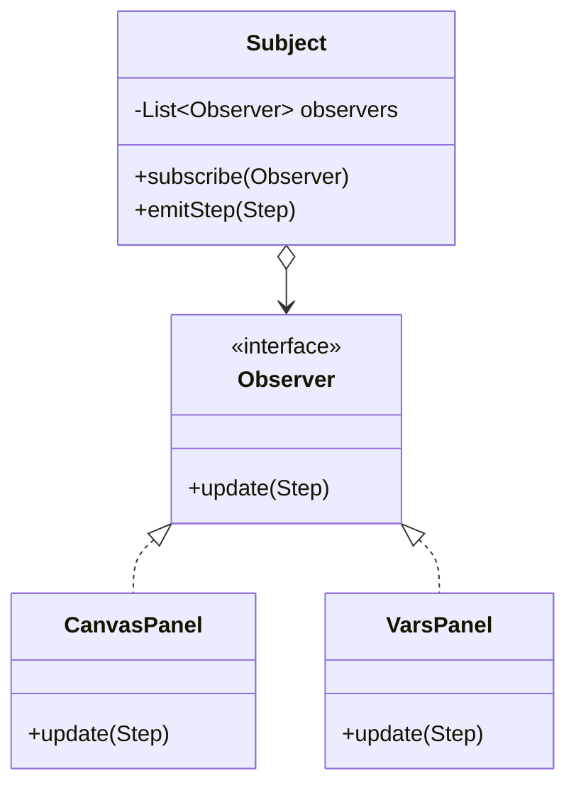

# 观察者模式

## 一句话

事件一发，多方响应——**Subject 只管广播，不关心谁在听。**

## 生活故事

公众号关注：你订阅了推送，作者发文章时平台群发给所有关注者。作者不认识你，你随时取关——**单向依赖，动态名单。**

## UML 类图（Mermaid 源码）

## 时序单步（右侧画布）

subscribe(canvas) → subscribe(vars) → emitStep → update→canvas → update→vars —— **同一条消息扇出到 N 条**

## 不变量（意图层）

- Subject 只维护订阅名单：一次 emit，按订阅顺序全部通知
- 双向解耦：加观察者不改 Subject 一行；Subject 换实现观察者无感

## 什么时候用 / 代价

- 一对多的事件联动；GUI、消息队列、Spring 事件全是它
- 代价：通知顺序、内存泄漏（忘 unsubscribe）、调试链路变长

## 🔗 本项目哪里用到了（反向引用）

- 引擎吐 `Trace` → `PlaybackController.fire()` → 画布/代码/变量/意图四个面板各自刷新——**纯手工观察者**
- `PlaybackController.addListener()` 就是 subscribe；`fire()` 就是 emitStep
