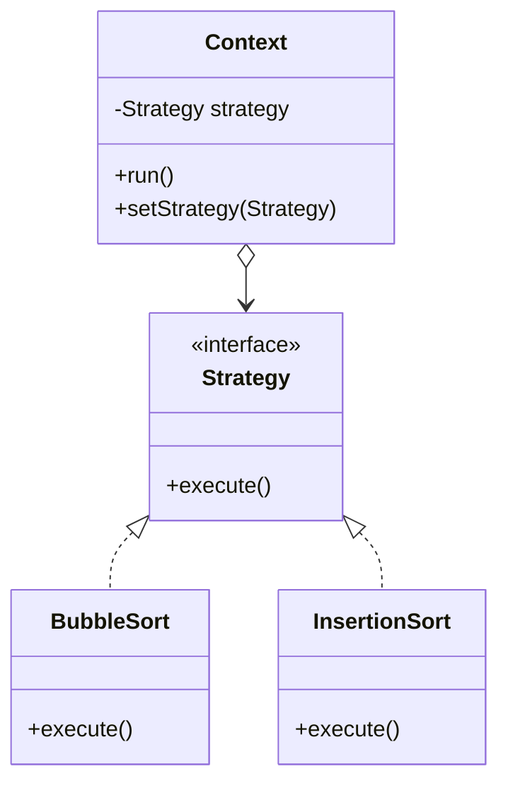

# 策略模式

## 一句话

「怎么做」抽成接口，运行时选实现——**换箭头，不换调用代码**。

## 生活故事

出门的「移动策略」：地铁/打车/骑车随便换，但"出发去公司"这句话不变。**策略 = 封装变化的那一半，Context = 固定的那一半。**

## UML 类图（Mermaid 源码，M5 后续接 WebView 渲染）

## 时序单步（右侧画布）

装配 → run() → execute()〔冒泡〕→ 返回 → **setStrategy → @1.strategy 箭头换位** → run() → execute()〔插入〕→ 返回

## 不变量（意图层）

- 调用方只认 `ctx.run()`——运行时换成哪个策略，**调用代码一行不改**
- Context 与策略之间只有接口：编译期不知道具体实现（多态分发的本体）

## 什么时候用 / 代价

- 同一问题多种解法且要运行时切换；消灭 if-else 大 Mig
- 代价：类数量膨胀；简单场景一个 lambda 就够（`Comparator` 就是策略）

## 🔗 本项目哪里用到了（反向引用）

- `engine/Algorithm.java` **就是那个 Strategy 接口**——10 个算法全是它的实现
- `AlgorithmRegistry` = Context 的装配处；`ui/` = 只认接口的调用方
- 你现在引擎里的每加一个算法不动 UI 一行——这就是策略模式在工作
