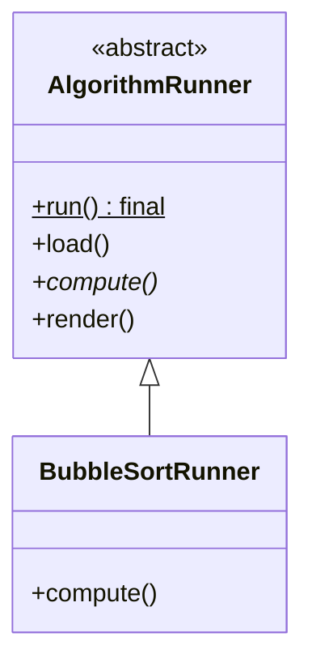

# 模板方法模式

## 一句话

骨架定死（final），步骤留钩子——**子类填内容，不碰顺序。**

## 生活故事

泡面说明书：烧水 → 下面 → 等 3 分钟 → 调料。顺序印死在包装上，你换的只是"面"这个变化点。

## UML 类图（Mermaid 源码）

## 时序单步（右侧画布）

run() → load()〔公共〕→ compute()〔子类〕→ render()〔公共〕—— **顺序永远 ①②③**

## 不变量（意图层）

- `run()` 是 final：顺序由父类锁死，子类只能填 compute 的内容
- 好莱坞原则：**别调用我们，我们会调用你**——控制权在骨架手里（和"框架回调你的钩子"同一回事）

## 什么时候用 / 代价

- 流程固定、步骤可变：框架生命周期、测试基类、JdbcTemplate
- 代价：继承绑定（组合优于继承的典型反例场景），钩子太多时骨架变成迷宫

## 🔗 本项目哪里用到了（反向引用）

- `Algorithm` 接口 + 各生产者的 `produce()` 就是这个形状：**建图层的流程一致，"算"的那步各不相同**
- `TreeEmitter` / `StepEmitter` 也是模板：emit 的骨架共享，snapshot 各域自填

## 变体

- 变体=模板方法+回调（钩子接口代替抽象方法）、组合版（Strategy 注入步骤）
